# Student B – Evidence Report

## E1 – SSH Remote Configuration

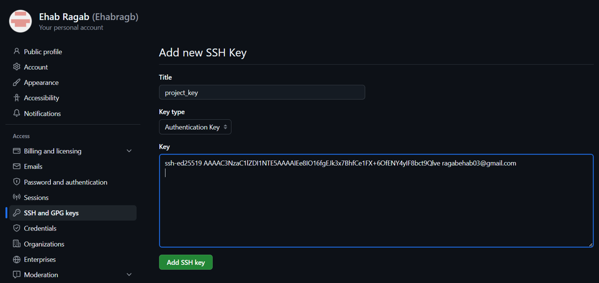

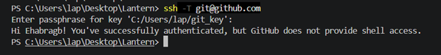

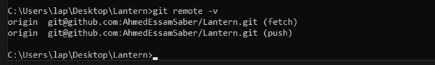

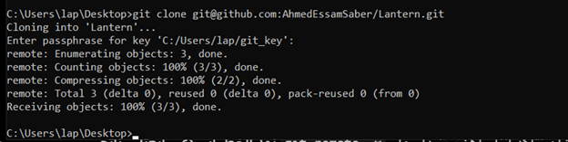

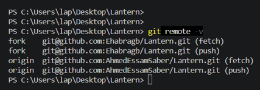

## E3 – Git Object Evidence

### Commit Hash

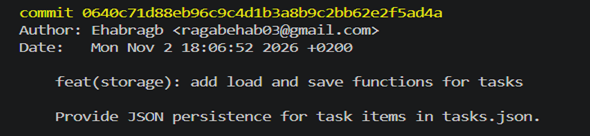

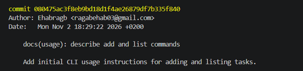

### Tree Hash

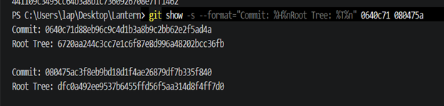

### Blob Hash Comparison

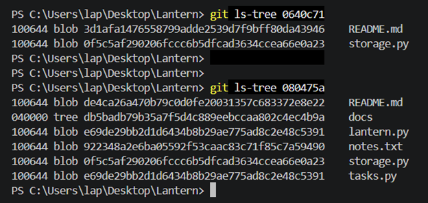

## E4 – Branching and Merging Graph

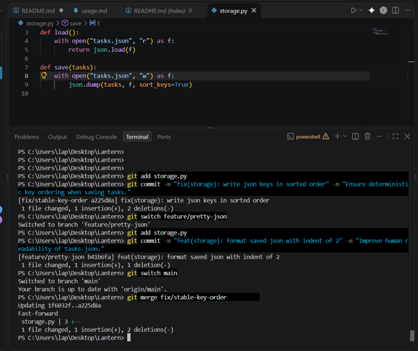

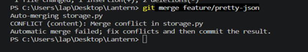

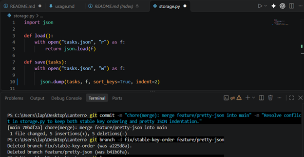

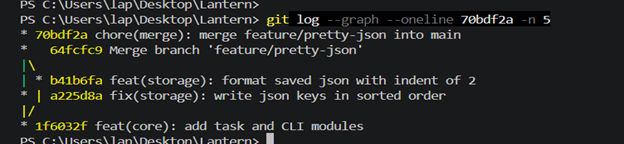

## E5 – Reflog Recovery Evidence

### drill (b)

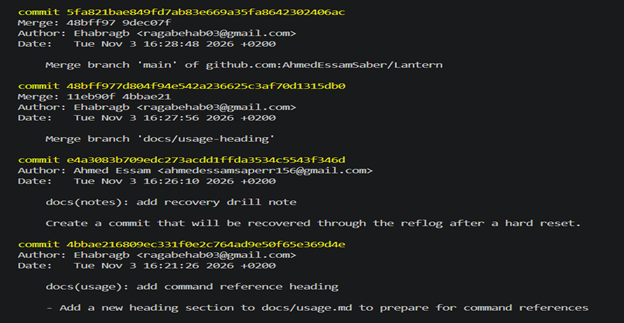

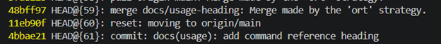

### drill (d)

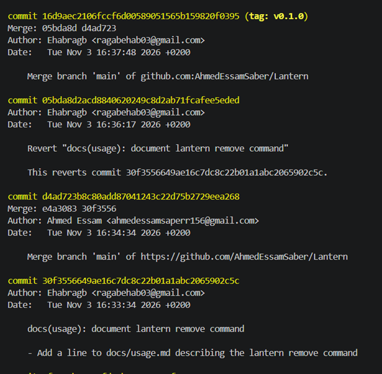

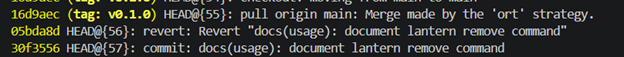

## E6 – Stash Evidence

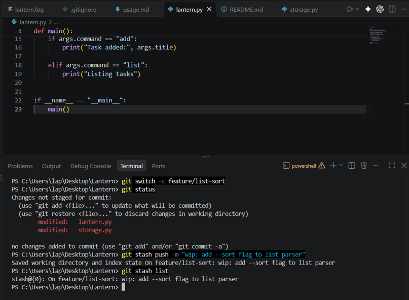